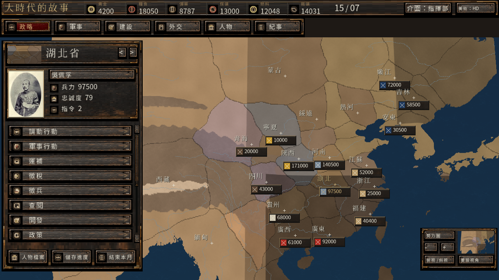
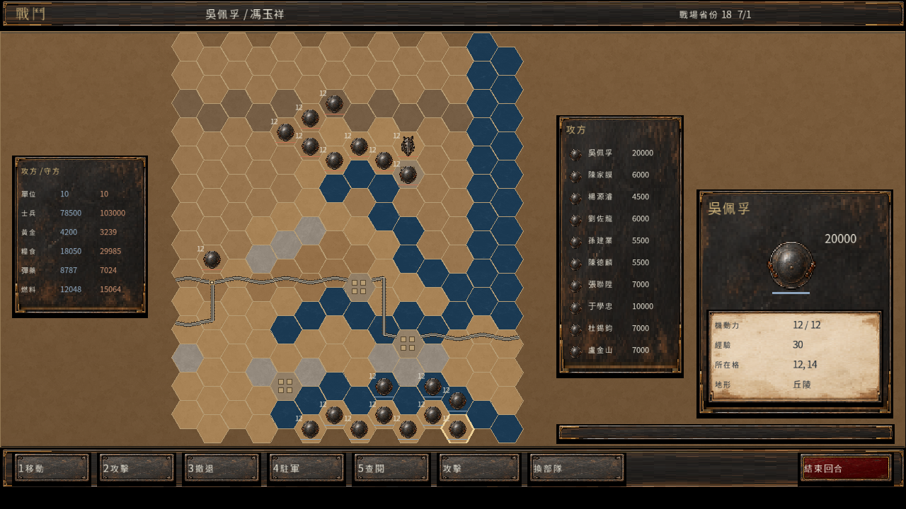

# 大時代的故事 remake

以 Go／Ebiten 重製漢堂國際資訊 1992 年 DOS 戰棋《大時代的故事》，保存繁體中文文本、軍政操作與原版素材的解碼方法，提供可切換的原版／HD 呈現及英日語系。

[下載正式版](https://github.com/wicanr2/great-era-remake/releases/latest) · [執行說明](docs/release/README.md) · [專案現況](CONTEXT.md) · [工作追蹤](https://github.com/wicanr2/great-era-remake/issues/1)

## 正式版

目前版本、內容數量、驗收結果與尚待確認的範圍統一記錄在 [CONTEXT.md](CONTEXT.md)。下載使用 [GitHub 最新正式版](https://github.com/wicanr2/great-era-remake/releases/latest)，已發布來源固定在對應 tag。

遊戲以民國初年的北伐與抗戰為背景。玩家管理省份資源、人事、外交與軍事，進入戰術畫面指揮部隊。重製版沿用已建立的規則與存檔實作，呈現改動及原版行為未知項保留於[發行規格](docs/spec/48-hd-release-integration.md)與[玩法驗證邊界](docs/playtest/43-remake-original-gameplay-diff.md)。

- 大地色指揮介面、可縮放及拖曳的全國地圖、俯視六角戰場與原版鐵路形狀。
- 美術與操作介面獨立切換，保留可操作的原版介面。
- 人物檔案可搜尋與翻頁，保留來源及待考標示；英日自傳的審閱狀態見專案現況。
- 專案原創 Ogg 配樂，沿用已試聽採用的混音，保存[來源紀錄](assets/music/modern/provenance.json)與[試聽確認](assets/music/modern/acceptance.json)。

正常玩家路徑、平台驗證及原版忠實度的聲明，以 [CONTEXT.md](CONTEXT.md)連結的實際收據為準。

## 遊戲畫面

以下為 v.1.0.1-20261014 在 Linux 容器中，以種子 1 從正常玩家介面擷取的畫面。圖片是實際渲染成果，展示新介面與美術；不能單獨證明原版規則等價。來源與雜湊見[展示收據](docs/spec/48-hd-release-integration.md#主要分支整併與展示收據)。





## 下載與執行

公開 Release 提供三平台引擎包、八曲原創配樂、三語資料及必要授權告知。玩家須自備合法原版遊戲資料與倚天字庫；公開包不含這些素材。

| 平台 | 公開封包入口 |
|---|---|
| Windows amd64 | `GreatEraRemake/launch.cmd` |
| macOS Apple Silicon | `GreatEraRemake.app/Contents/MacOS/launch` |
| Linux x86_64 | 解壓縮後的 `AppDir/AppRun` |

例如在 Linux，以絕對路徑指定自己的資料：

```sh
./AppDir/AppRun -game /路徑/遊戲資料 -eten /路徑/eten
```

完整的平台需求、語系、存檔位置與參數見[執行說明](docs/release/README.md)。

| 操作 | 功能 |
|---|---|
| `F2` | 切換原版／HD 美術 |
| `F4` | 切換原版／指揮介面 |
| 滾輪、拖曳 | 縮放、移動全國地圖 |
| `ESC` | 取消或返回 |
| `F10`，再按 `Y` | 儲存並離開 |
| `-audio off` | 關閉配樂 |

專案根目錄 `dist-all/<版本>/` 是本機交付入口，集中引擎包、[完整版](docs/release/FULL-LOCAL.md)、影音及驗證。完整版與 DOS／重製原版／HD 比較片含原版資料或畫面，保留本機，不在公開 Release 附件內。

## 開發與文件

分析、建置、測試及錄影使用 Docker。既有包裝器與工具需求見 [AGENTS.md](AGENTS.md)；三平台建置使用 [tools/package.sh](tools/package.sh)，會執行回歸、架構及內容檢查。原始遊戲資料放在忽略版控的 `workplace/orig/`，只作唯讀輸入。

| 入口 | 內容 |
|---|---|
| [CONTEXT.md](CONTEXT.md) | 目前狀態、有效決策及歷史證據導航 |
| [GitHub Issues](https://github.com/wicanr2/great-era-remake/issues/1) | 現行工作與後續驗收的唯一追蹤入口 |
| [WORKLOG.md](WORKLOG.md) | 主要分支整理及後續工作紀錄 |
| [發行文件](docs/release/README.md) | 平台、資料匯入、存檔與重建方式 |
| [整合規格](docs/spec/48-hd-release-integration.md) | HD、六角戰場、人物、音訊與發行邊界 |
| [遊戲機制索引](docs/mechanics/00-index.md) | 政略、軍事、經濟、人事、AI 與勝負規則 |
| [原版函式索引](docs/re/00-function-index.md) | 逆向定位與推論等級 |
| [字模文本格式](docs/formats/01-glyph-text.md) | 原版詞表還原方法及驗證 |
| [譯名表](translations/glossary.md) | 多語系名稱對照 |
| [第三方告知](docs/licenses/THIRD-PARTY-NOTICES.md) | 字型、生成圖集、照片及軟體來源 |

`dosgolem/` 保存研究時使用的獨立工具源碼快照及本專案必要的鍵盤補丁，不是遊戲引擎依賴。能力與來源見其 [README](dosgolem/README.md)及[匯入紀錄](WORKLOG.md)。

## 授權與致謝

專案採 [RRSAL-1.0](LICENSE)，識別碼為 `LicenseRef-RRSAL-1.0`，屬 source-available。非商業使用、修改及再散布依條款辦理；實況、影片、報導與平台分潤依條款允許並須署名，商業用途需書面授權。聯絡：wicanr2@gmail.com。

原版執行檔、遊戲資料、美術、音樂及倚天字型不在專案授權範圍，也不隨公開包散布。版控中的 `docs/images/*.png` 是經核准的成果展示；三張生成 HD 圖集另有[精確白名單與來源](docs/licenses/generated-hd-assets.json)。提交與發行前使用 [tools/deny_scan.sh](tools/deny_scan.sh)檢查。

感謝原作漢堂國際資訊、程式作者林明輝與沈友瑋、音樂作者吳宗凱與遊戲工場。本專案為非官方保存與重製工作，與原作權利人無隸屬關係。
