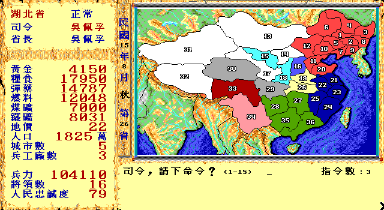
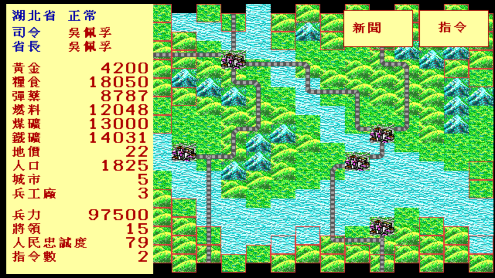
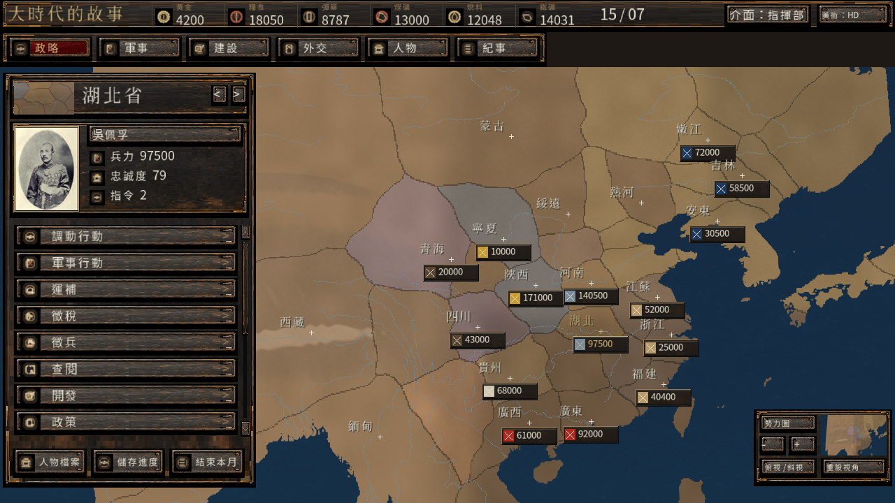
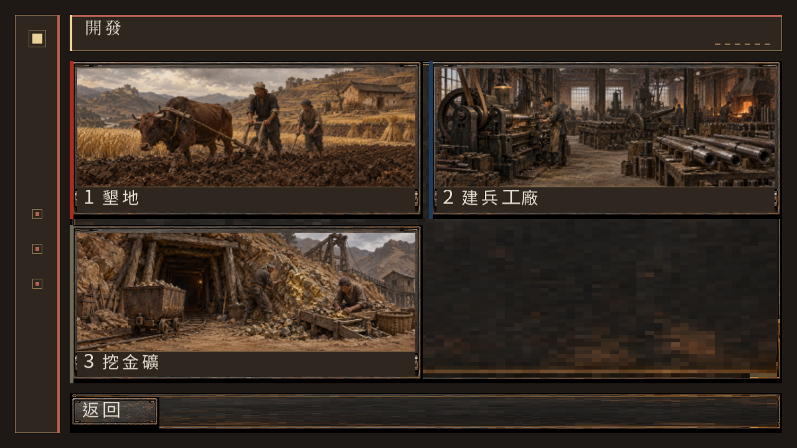
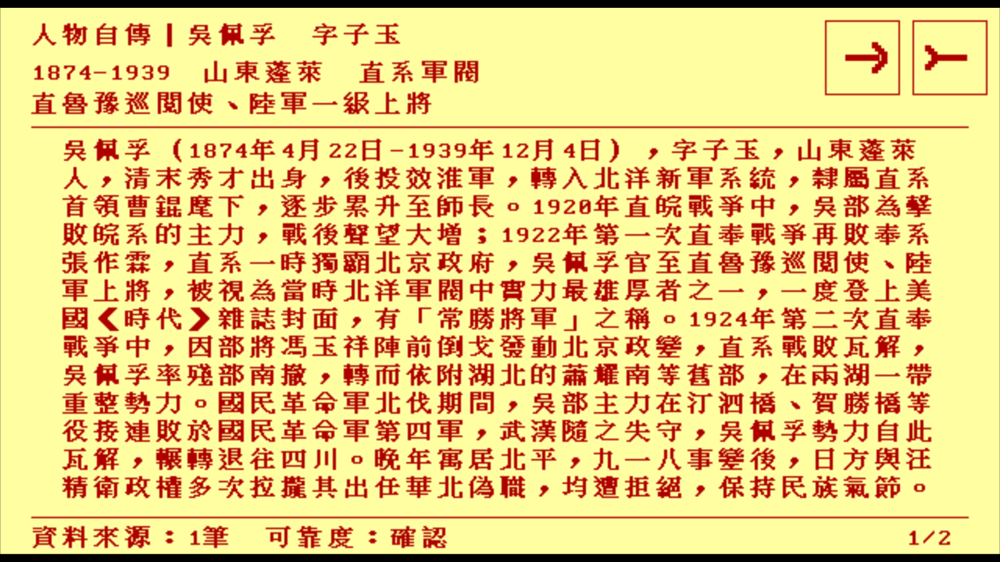
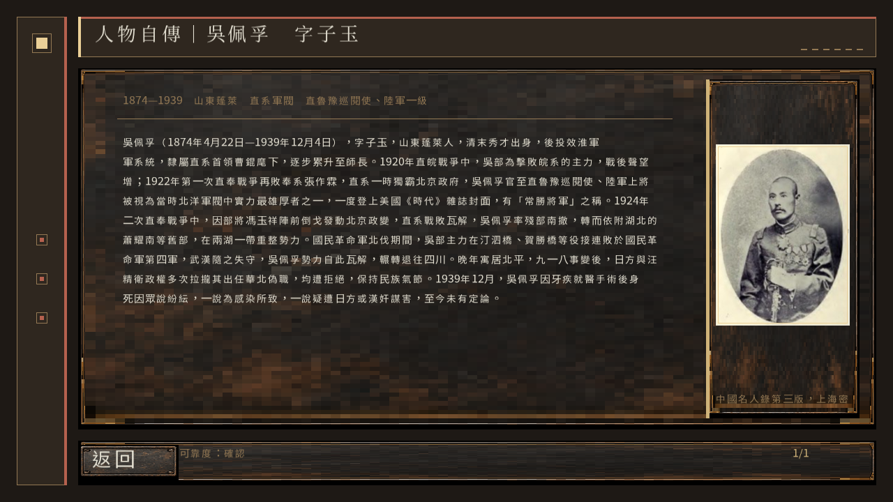
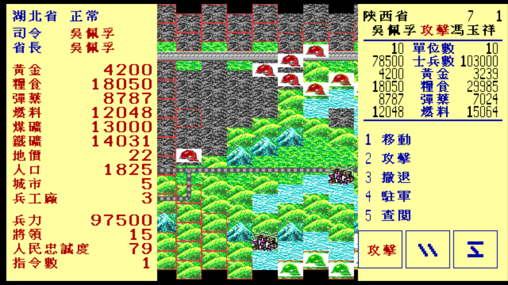

# 大時代的故事 HD 重製版

從全國局勢到前線戰場，重回北伐與抗戰年代。

本作重製漢堂國際資訊於 1992 年推出的 DOS 策略遊戲《大時代的故事》。延續原作的軍政經營與回合制戰棋，加入重新設計的 HD 介面、地圖、兵種美術與原創配樂，並保留原版美術及操作介面的切換。

[下載正式版](https://github.com/wicanr2/great-era-remake/releases/latest) · [原版與 HD 對照](#原版與-hd-對照) · [執行說明](docs/release/README.md)

## 故事背景

二十世紀上半葉的中國，歷經軍閥割據、北伐與抗日戰爭。各省的兵力、軍需與將領構成局勢，每一次調動、徵兵與外交，都牽動下一步部署。

遊戲提供三個歷史時期。北伐從各地勢力並立的局面展開；抗戰前期將視線轉向全面戰爭；抗日後期則置身太平洋戰爭爆發後的局勢。

| 歷史時期 | 劇本起點 |
|---|---|
| 北伐時期 | 1926 年 7 月 |
| 抗戰前期 | 1937 年 7 月 |
| 抗日後期 | 1941 年 12 月 |

你需要在全國地圖上安排軍政行動，籌措黃金、糧食與軍需，管理省份並調動將領。進入戰場後，再逐支指揮部隊，選擇移動、攻擊或撤退。人物檔案也讓地圖上的名字有了生平與史料脈絡。

## 怎麼玩

- **經營省份**：徵稅、開發、徵兵與運補，安排有限的軍政指令。
- **調度將領**：查閱人物與部隊資料，進行任用、整編及調動。
- **處理外交**：透過外交與談判介面安排對外行動。
- **指揮戰場**：在六角格上選取部隊、移動及下達攻擊指令，觀察地形與鐵路配置。

## 這次 HD 重製了什麼

**軍政指揮介面**參考《鋼鐵雄心 IV》與《大戰略》的操作布局，以頂部資源列、中央地圖、側欄資料與底部指令集中呈現局勢。土褐、砂岩、鐵黑與暗紅搭配磨損金屬邊框，延續原作的戰爭年代感。

**全國地圖與戰術戰場**重新繪製地表材質。全國地圖可以縮放、拖曳及切換觀看角度；戰術畫面採俯視六角格，兵種保留原版辨識特徵，加入鋼鐵質感。鐵路沿用原版連接與形狀。

**人物自傳**提供全文、照片、搜尋、分頁與來源閱讀。資料不足的人物保留待考標示；英文與日文自傳保留機器翻譯草稿標示。

**原創配樂**重新混音，使用 Ogg 播放，可獨立開關。美術與介面也能分開切換，讓原版介面搭配 HD 美術，或讓新介面搭配原版美術。

## 原版與 HD 對照

「DOS 原版」由原始程式執行；「重製原版」與「重製 HD」是同一重製版的兩種顯示方式。以下都是實際遊戲畫面，DOS 與重製版使用不同遊戲進度。點選圖片可查看原尺寸。

### 全國地圖與軍政介面

| DOS 原版 | 重製原版 | 重製 HD |
|---|---|---|
|  |  |  |

### 開發與建設

墾地、建兵工廠與挖金礦使用獨立場景插圖，以土褐、煙塵及磨損鋼鐵呈現年代感。可點選卡片，也可使用數字鍵下令。



### 人物自傳

| 重製原版 | 重製 HD |
|---|---|
|  |  |

### 戰術戰場

| 重製原版 | 重製 HD |
|---|---|
|  |  |

本機推廣片另收錄 DOS 原版、重製原版與 HD 的操作錄影，入口為本機交付目錄 `dist-all/<版本>/index.html`。影片含原版遊戲畫面，保留於本機交付。

## 下載與開始遊戲

從 [GitHub 最新正式版](https://github.com/wicanr2/great-era-remake/releases/latest)下載適合的平台。公開下載提供引擎、HD 素材、原創配樂與三語資料；玩家須自備合法原版遊戲資料及倚天字庫。

| 平台 | 啟動入口 |
|---|---|
| Windows x64 | `GreatEraRemake/launch.cmd` |
| macOS Apple Silicon | `GreatEraRemake.app/Contents/MacOS/launch` |
| Linux x86_64 | `AppDir/AppRun` |

例如在 Linux 指定自己的資料目錄：

```sh
./AppDir/AppRun -game /路徑/遊戲資料 -eten /路徑/eten
```

資料匯入、系統需求、語系與存檔位置見[執行說明](docs/release/README.md)。

| 操作 | 功能 |
|---|---|
| `F2` | 切換原版／HD 美術 |
| `F4` | 切換原版／指揮介面 |
| 滾輪、拖曳 | 縮放與移動全國地圖 |
| `ESC` | 取消或返回 |
| `F10`，再按 `Y` | 儲存並離開 |

目前版本與平台驗收範圍見 [CONTEXT.md](CONTEXT.md)，問題回報請使用 [GitHub Issues](https://github.com/wicanr2/great-era-remake/issues)。

## 授權與致謝

本專案採 [RRSAL-1.0](LICENSE)，非商業使用、修改、再散布與影片使用依授權條款辦理。原版執行檔、資料、美術、音樂及倚天字型不隨公開包散布。第三方素材來源見[授權告知](docs/licenses/THIRD-PARTY-NOTICES.md)。

感謝原作漢堂國際資訊、程式作者林明輝與沈友瑋、音樂作者吳宗凱與遊戲工場。本專案為非官方保存與重製工作，與原作權利人無隸屬關係。
