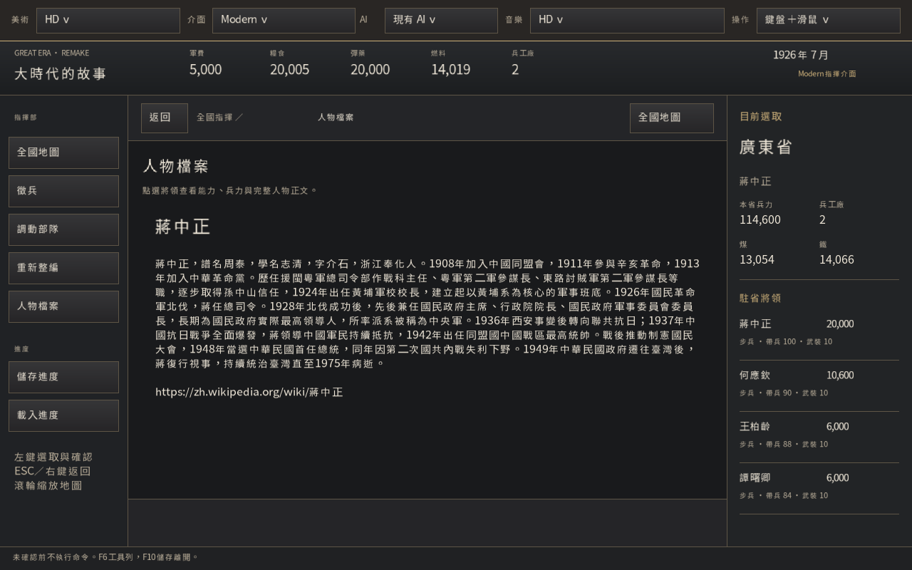
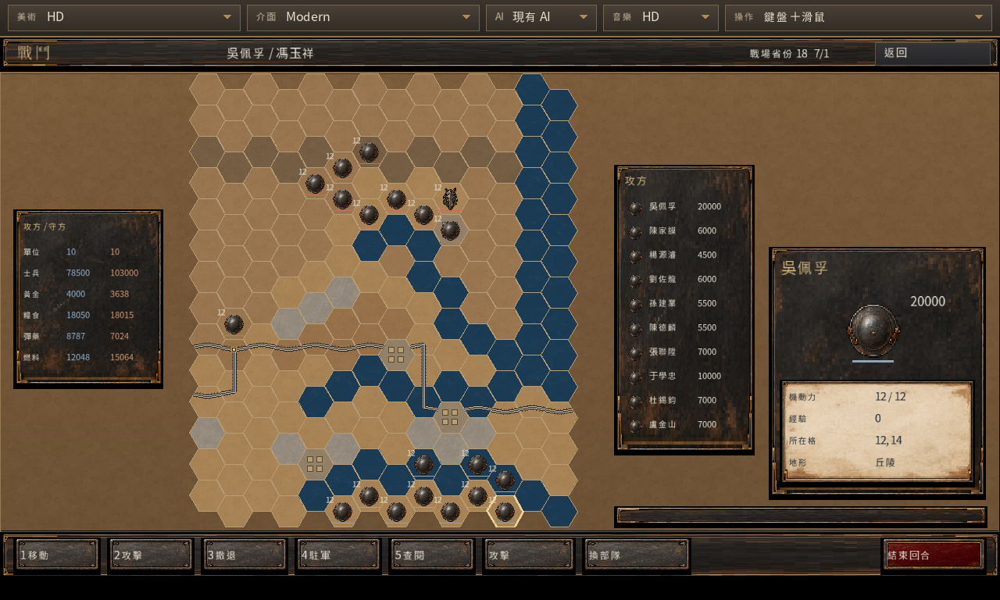
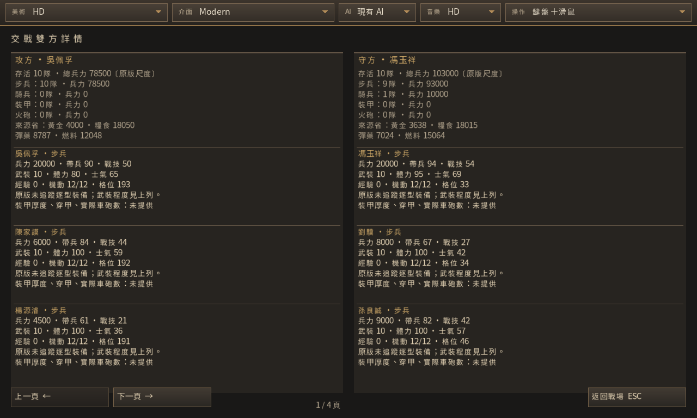

# 大時代的故事 HD 重製版

從全國局勢到前線戰場，重回北伐與抗戰年代。

北伐軍向北推進，地方勢力各據一方；抗戰烽火燃起，戰局也從勢力角逐轉向對日作戰。你將從北伐與抗戰的三個歷史時期選擇開局，在全國地圖上管理省份、調動將領，為前線籌措糧食與軍需，再親自指揮六角格戰場上的部隊。前線等待增援，後方也需要建設；有限的軍政指令，讓每一次開發、徵兵與出兵都得仔細安排。

本作重製漢堂國際資訊於 1992 年推出的 DOS 策略遊戲《大時代的故事》。延續原作的軍政經營與回合制戰棋，加入 HD 地圖、兵種美術、Modern 滑鼠操作與重新編配的音樂，並保留原版美術及操作介面的切換。

[下載正式版](https://github.com/wicanr2/great-era-remake/releases/latest) · [原版與 HD 對照](#原版與-hd-對照) · [執行說明](docs/release/README.md)

## 故事背景

二十世紀上半葉的中國，歷經軍閥割據、北伐與抗日戰爭。各省的兵力、軍需與將領構成局勢，每一次調動、徵兵與外交，都牽動下一步部署。

遊戲提供三個歷史時期。北伐從各地勢力並立的局面展開；抗戰前期將視線轉向全面戰爭；抗日後期則置身太平洋戰爭爆發後的局勢。

| 歷史時期 | 劇本起點 |
|---|---|
| 北伐時期 | 1926 年 7 月 |
| 抗戰前期 | 1937 年 7 月 |
| 抗日後期 | 1941 年 12 月 |

你需要在全國地圖上安排軍政行動，籌措黃金、糧食與軍需，管理省份並調動將領。進入戰場後，再逐支指揮部隊，選擇移動、攻擊或撤退。人物檔案也讓地圖上的名字有了生平與史料脈絡。

## 怎麼玩

- **經營省份**：徵稅、開發、徵兵與運補，安排有限的軍政指令。
- **調度將領**：查閱人物與部隊資料，進行任用、整編及調動。
- **處理外交**：透過外交與談判介面安排對外行動。
- **指揮戰場**：在六角格上選取部隊、移動及下達攻擊指令，觀察地形與鐵路配置。
- **選擇勢力**：三個劇本共 14 個開局選項，包含原有日軍勢力。
- **軍備整備**：中國勢力可選擇重製版擴充的整備試玩，研究步槍、火炮與戰車，再安排生產、庫存、換裝及步兵改編裝甲。統一後的日軍入侵戰役仍在開發。

## 這次 HD 重製了什麼

**Modern 操作介面**參考《鋼鐵雄心 IV》與《大戰略》的布局，以資源列、中央地圖、側欄資料與底部指令集中呈現局勢。徵兵可拖曳滑桿，調動可直接點選省名與將領；固定的返回、地圖與確認按鈕，讓滑鼠操作更清楚。土褐、砂岩、鐵黑與暗紅搭配磨損金屬邊框，延續原作的戰爭年代感。

**全國地圖與戰術戰場**重新繪製地表材質。全國地圖可以縮放、拖曳及切換觀看角度；戰術畫面採俯視六角格，兵種保留原版辨識特徵，加入鋼鐵質感。鐵路沿用原版連接與形狀。

**人物自傳**收錄 392 篇中文正文，可從部隊資料閱讀全文與來源，並以滾輪捲動。24 位資料不足的人物保留待考標示；英文與日文自傳保留機器翻譯草稿標示。

**原曲 HD 配樂**以八首 DOS 原曲為基礎，加入銅管、弦樂、軍鼓與定音鼓。本機完整版另收錄《還我河山》《國民革命歌》《歌八百壯士》，可在遊戲內指定播放；公開引擎包提供八首專案原創配樂。所有版本都可即時切換 HD、原版或靜音，美術、介面與音樂分別保存設定。

**雙方戰鬥資料**並列兵種、兵力與將領；整備模式另列實際配裝、缺裝與火力。戰術畫面可暫停返回地圖查閱，再繼續同一場戰鬥；整編取消時還原部隊及裝備帳。

## 原版與 HD 對照

「DOS 原版」由原始程式執行；「重製原版」與「重製 HD」是同一重製版的兩種顯示方式。以下都是實際遊戲畫面，DOS 與重製版使用不同遊戲進度。點選圖片可查看原尺寸。

### 全國地圖與軍政介面

| DOS 原版 | 重製原版 | 重製 HD |
|---|---|---|
|  |  |  |

### 開發與建設

墾地、建兵工廠與挖金礦使用獨立場景插圖，以土褐、煙塵及磨損鋼鐵呈現年代感。可點選卡片，也可使用數字鍵下令。


### Modern 操作與軍備整備

徵兵可用滑桿與數量按鈕預覽花費，再確認下令。整備試玩以研究、生產、庫存與換裝串起裝備管理。


### 人物自傳

| 重製原版 | 重製 HD |
|---|---|
|  |  |

### 戰術戰場

| 重製原版 | 重製 HD |
|---|---|
|  |  |

雙方兵力、兵種與將領並列查看，不需離開戰場。



本機推廣片另收錄 DOS 原版、重製原版與 HD 的操作錄影，入口為本機交付目錄 `dist-all/<版本>/index.html`。影片含原版遊戲畫面，保留於本機交付。

## 下載與開始遊戲

從 [GitHub 最新正式版](https://github.com/wicanr2/great-era-remake/releases/latest)下載適合的平台。公開下載提供引擎、HD 素材、原創配樂與三語資料；玩家須自備合法原版遊戲資料及倚天字庫。

| 平台 | 啟動入口 |
|---|---|
| Windows x64 | `GreatEraRemake/launch.cmd` |
| macOS Apple Silicon | `GreatEraRemake.app/Contents/MacOS/launch` |
| Linux x86_64 | `AppDir/AppRun` |

例如在 Linux 指定自己的資料目錄：

```sh
./AppDir/AppRun -game /路徑/遊戲資料 -eten /路徑/eten
```

資料匯入、系統需求、語系與存檔位置見[執行說明](docs/release/README.md)。

選擇劇本與勢力後即可開局；已有進度可在同一畫面繼續。


| 操作 | 功能 |
|---|---|
| `F2` | 切換原版／HD 美術 |
| `F4` | 切換原版／Modern 介面 |
| `F7` | 在整備模式開啟軍備局 |
| 滾輪、拖曳 | 縮放與移動全國地圖 |
| `ESC` | 取消或返回 |
| `F10`，再按 `Y` | 儲存並離開 |

`F2` 與 `F4` 可在遊戲進行中即時切換，不需重新啟動，也不改動遊戲進度。首次啟動預設為 Modern 介面、HD 美術、滑鼠與 HD 音樂。遊戲中可從常駐工具列切換音樂，選擇會保存至下次啟動；`-audio off` 可暫時指定靜音。

## 常駐工具列

常駐工具列放在完整遊戲畫面上方。美術、介面、音樂及輸入設定可隨時調整，不需重新啟動。

| 工具列 | 功能 |
|---|---|
| 美術 | 即時切換原版／HD |
| 介面 | 即時切換原版／Modern 介面，與美術獨立 |
| AI | 查看現有重製 AI 說明，策略與難度沿用現況 |
| 音樂 | HD／原版／靜音；自動選曲或指定曲目，本機完整版另有三首軍歌 |
| 操作 | 鍵盤加滑鼠／純鍵盤，偏好可保存；工具列始終接受滑鼠操作 |


本機完整版可直接雙擊 Windows 的 `dsds.exe`、macOS 的 App，或 Linux 的 AppImage。無需輸入參數，資料會從封包位置載入；存檔與偏好寫入系統使用者目錄。公開引擎包仍需自備資料與字庫。

進度保存為單一 `campaign.gesave`，可在開局畫面繼續遊戲，也保留 DT1 匯入。軍歌只有 HD 音源；切到原版音樂時播放原版情境曲，回到 HD 後恢復指定軍歌。

滑鼠左鍵可選指令、輸入數字並操作戰術；右鍵取消或返回。滾輪可縮放全國地圖及翻閱人物、新聞，按住左鍵可拖曳地圖。`F6` 將鍵盤焦點移入工具列，左右選欄、上下選項，按 Enter 套用，Esc 返回。工具列選單開啟時會攔截輸入，避免誤點下方遊戲。

目前版本與平台驗收範圍見 [CONTEXT.md](CONTEXT.md)，問題回報請使用 [GitHub Issues](https://github.com/wicanr2/great-era-remake/issues)。

## 授權與致謝

本專案採 [RRSAL-1.0](LICENSE)，非商業使用、修改、再散布與影片使用依授權條款辦理。原版執行檔、資料、美術、音樂及倚天字型不隨公開包散布。第三方素材來源見[授權告知](docs/licenses/THIRD-PARTY-NOTICES.md)。

感謝原作漢堂國際資訊、程式作者林明輝與沈友瑋、音樂作者吳宗凱與遊戲工場。本專案為非官方保存與重製工作，與原作權利人無隸屬關係。
